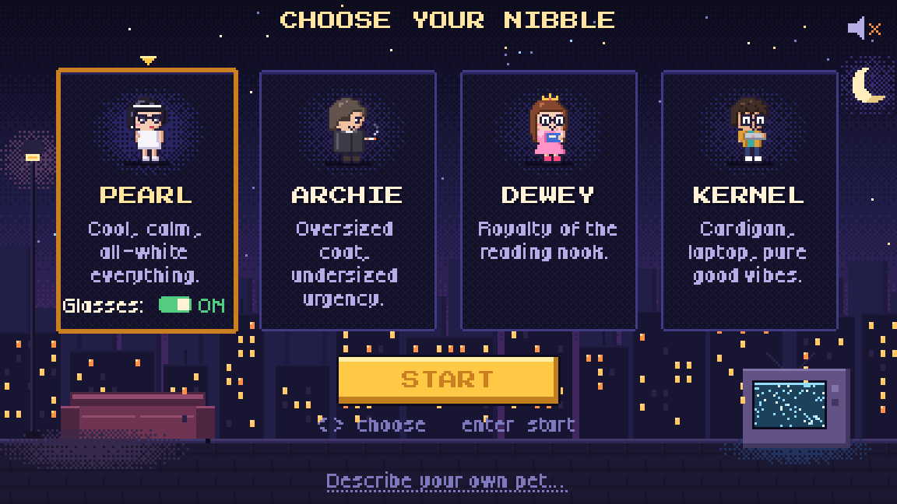
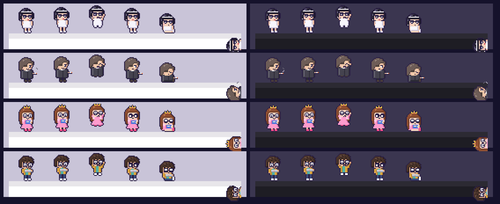

# nibble

A pixel-art desktop pet for macOS that lives on top of your windows. It hangs out on the edge of whatever window you're using, follows you between windows, cheers you on while you work, and peeks in from the side when a window has no room above it.



> **Status:** the home page and its four built-in pets work with no API key and no setup, along with window life, cheering and peeking. Describing your own pet (LLM-generated) and the downloadable `.app`/`.dmg` are on the way. Full install instructions land with the `.dmg`.

## Run it (development)

```sh
brew install uv
cd nibble
uv run nibble run            # Ctrl-C or the menu bar icon to quit
uv run nibble run --demo     # fast timers, for recording (see below)
uv run nibble run --debug    # outline every edge a pet can stand on
```

## What it does

### Choose your nibble

On first launch (and any time from the menu bar → **Choose your nibble…**) a little 16-bit character select opens. It's set on a moody night rooftop with twinkling stars, a flickering streetlamp, a couch and a TV full of static.

- **Choosing:** use ← → or click a card. The selected card glows gold and bounces, and its pet does a happy hop.
- **Pearl's glasses:** her card has a **Glasses: ON/OFF** switch (or press G). The preview updates live, and so does a Pearl who's already out.
- **Starting:** **START** (or Enter) drops the pet onto your window and closes the page. If a pet is already out, it asks whether to **swap** or **add** another.
- **Sound:** retro sound effects are off until you click the speaker in the top-right corner (or press M).
- **Your own pet:** **Describe your own pet…** at the bottom is for people with an OpenRouter key (coming in the next update).

The page is drawn at its true 384×216 resolution and scaled up by a whole number with no smoothing, so it's pixel-crisp on Retina and non-Retina displays. Your pets and their accessories are remembered, and they come back on the next launch.

### The cast

Four hand-made pets, built in to work with no key:



| | |
|---|---|
| **Pearl** | Cool, calm, all-white everything. Retro cat-eye shades, optional. |
| **Archie** | Oversized coat, undersized urgency. Has a tiny smoke wisp while he idles. |
| **Dewey** | A princess of the reading nook: tiara, big glasses and a book. |
| **Kernel** | Cardigan, laptop, pure good vibes. |

Each one has every animation (idle, walk, sit, sleep, happy, eat, dangle, fall, side-eye, plus peeking), a personality, and a full set of lines in their own voice. Sprite sheets are in [`docs/sprites/`](docs/sprites).

### Lives on your windows

- **Where it goes:** it sits on the top edge of the focused window. When you switch windows (including between two windows of the same app), it waits a moment, then makes one calm hop over. Flick back and forth quickly and it stays put.
- **Riding and falling:** it rides along when you drag the window. If the window closes or minimizes, it falls, then heads to the newly focused window.
- **Picking it up:** drag to pick it up (it dangles by the scruff), or throw it. It stays wherever you drop it until you switch windows. Dropping it is the only way it stays on the bottom of the screen.
- **Cursor:** click it for a quip. Hover just above it on purpose and it trots after your cursor for a moment, then loses interest.
- **Naps:** it naps with zzz's. It wakes when your cursor comes near.

### Energy

How much the pet moves is up to you (menu bar → **Energy**). Blinking and other small idle motion happen at every level; what changes is how much it travels. Measured over a simulated half hour of you working:

| | Chill (default) | Normal | Hyper |
|---|---|---|---|
| Walks | ~4 per 30 min, at most one every 2.5 min | ~80 | ~230 |
| Distance walked | ~300 pt | ~12,700 pt | ~48,000 pt |
| Walk speed | 26 pt/s, 30–110 pt at a time | 42 pt/s | 64 pt/s |
| Sits | 40–120 s | 5–14 s | 2–6 s |
| Naps | often (30% of sits, 1–4 min) | rarely | never |
| Before following you | 1.2–2.2 s, then a slow hop | 0.5–1 s | 0.1–0.3 s |
| Cursor chase | after a 1.5 s hover; gives up after 2.5 s; ignores you for 90 s | 0.7 s / 4 s / 40 s | 0.25 s / 8 s / 15 s |

The original behavior walked about 26,000 pt in the same half hour. These figures are for a Large pet; distances and speeds scale with the pet's size (two-thirds at Medium, half at Small), so a smaller pet doesn't look like it's sprinting.

### Size

Menu bar → **Size**: Small (48 pt), **Medium (64 pt, default)**, or Large (96 pt). It applies immediately and is remembered.

The pixel art stays crisp at every size: nearest-neighbor scaling only, with every sprite pixel covering a whole number of device pixels. On Retina displays all three sizes are exact (Small is 3 device pixels per sprite pixel). On a non-Retina display the scale rounds to the nearest whole number, so Small shows at 32 pt there (1.5 rounds down to keep it smaller than Medium). Medium and Large are unchanged. The pet re-snaps as it moves between displays.

Everything tied to the pet's size follows it: what you can click, how far it pokes in when peeking, how close the cursor has to be, where speech bubbles and z's attach, and its hop and walking speed.

### Where the pet can be

| Focused window | The pet |
|---|---|
| Room above it | Sits on its top edge |
| Split View half | Peeks in from that window's outer screen edge, never from the divider |
| Tiled (including with macOS tiling margins) | Peeks from the side touching the screen edge |
| Maximized or fullscreen | Peeks from the left or right edge (prefers left; scrollbars live on the right) |
| No room above, touching neither side | Peeks from the side nearer the screen edge |
| Nothing focused | Stays where it is; if it's on the bottom of the screen, it peeks from the screen edge |

Switch focus between two split halves and it ducks out, then reappears on the other window's outer side.

### Cheers you on

<!-- GIF placeholder, add once recorded:  -->

Every so often the pet pops a gold speech bubble with a bounce and some sparkles, encouraging you in its own voice. It reacts to three things:

| Trigger | When |
|---|---|
| Focus | 20 minutes in coding, terminal or writing apps, then again every 25 more minutes. Social, video or call apps reset the streak. Browsers and other apps pause it. |
| Welcome back | About 4 seconds after you return from 10+ minutes away (it wakes up for this one) |
| Random | An occasional nudge while you're actively working (about every 40 minutes on average) |

It never cheers more than once every 15 minutes, and never during a video call, while asleep, or in Quiet mode. Turn it off with **Cheer me on** in the menu bar.

Cheers come from the pet's own `cheers` lines (8–10 per pet). Pets without any fall back to a built-in generic set.

### Peeking

<!-- GIF placeholder, add once recorded:  -->

When the focused window has no room above it, the pet hops to the window's outer side and peeks in from there:

- **At rest:** it lies sideways, mostly hidden, with just its head poking in.
- **Looking around:** every so often it slides in a bit, turns its head, maybe says something, then settles back. Sometimes it ducks out and reappears somewhere else.
- **Your cursor:** rest the cursor in front of its face and it pops all the way in. It retreats when the cursor leaves, and never stays out more than about 6 seconds.
- **Staying out of the way:** it peeks only in the middle half of the window's height, away from tabs and the Dock. A cursor right at the edge (going for a scrollbar) doesn't count. A click near it makes it duck out of the way.
- **Clicks:** only its visible pixels catch the mouse.
- **Moving windows:** if the window moves or resizes, the pet moves with it.
- **Room again:** when the window has room above it again (or you focus one that does), the pet slides out, stands up, and hops back onto the window edge.

Peeking reuses the pet's idle, happy and walk frames, rotated and clipped, so every pet can do it without new art.

### Stays quiet when it should

During video calls the pet sits still and says nothing. A call is detected when a call app is in front (Zoom, Teams, FaceTime, Webex…) or any camera is on, which covers Google Meet in a browser. **Quiet mode** silences all bubbles. It still moves around.

## Menu bar

| Item | |
|---|---|
| Choose your nibble… | The home page |
| Cheer me on | On by default |
| Quiet mode | No speech bubbles at all |
| Energy | Chill (default), Normal, Hyper |
| Size | Small, Medium (default), Large |
| Drop pets in again | Re-run the entrance (handy for retakes) |
| Show standable edges | The `--debug` overlay |
| Quit nibble | |

Settings are saved in `~/Library/Application Support/nibble/settings.json`.

## Demo mode (for recording)

`nibble run --demo` speeds up the slow timers so each moment can be caught in one take. It also moves at the original, lively pace whatever the Energy setting:

| | Without `--demo` | Demo |
|---|---|---|
| Minimum gap between cheers | 15 min | 30 s |
| Focus cheer | after 20 min | after 40 s |
| "Away" (for welcome back) | 10 min | 20 s |
| Random cheers | ~every 40 min | ~every 80 s |
| Sleep after you go idle | 2 min | 12 s |
| Before following you to a window | 1.2–2.2 s | 0.15–0.45 s |
| Peek look-arounds (Chill) | every 45–100 s | every 4–9 s |

## Privacy and permissions

nibble needs **no** Accessibility, Input Monitoring, Screen Recording or camera permission. It only reads:

- **Windows:** their positions and owning app, via `CGWindowListCopyWindowInfo`. It never reads window titles or contents.
- **Your activity:** which app is frontmost (`NSWorkspace`), and how long since your last keypress or mouse move (a counter, not your keystrokes).
- **Mouse:** the pointer position and whether a button is held.
- **Camera:** whether any camera is in use (a device-status flag; it never opens the camera).

## Pet format

A pet is a JSON file with a palette, 32×32 palette-indexed frames for each animation (`idle`, `walk`, `sit`, `sleep`, `happy`, `eat`, `dangle`, `fall`, `sideeye`), and lines:

| Lines | Count |
|---|---|
| `quips` | 8–12 |
| `petting` | 5–8 |
| `hungry` | 5–8 |
| `fed` | 4–6 |
| `bored` | 3–6 |
| `cheers` | 8–10 |
| `chatter.openers`, `chatter.replies` | 4–6 each |
| `reactions.coding`, `.terminal`, `.social` | 3–5 each |

Every line is at most 60 characters. `nibble.core.validate` checks all of this, repairs small slips, and produces error messages precise enough to send back to the model.

### Accessories

A pet can have optional overlays, like Pearl's glasses. Pets without them (Archie, Dewey, Kernel, anything generated so far) keep working unchanged. Two optional keys:

```jsonc
"anchors": {
  "eyes": { "idle": [[11, 10], [11, 10]], "walk": [[11, 10], [11, 9], [11, 10], [11, 9]], ... }
},
"accessories": {
  "glasses": { "label": "Glasses", "anchor": "eyes", "default": true, "sprite": ["1..........1", ...] }
}
```

- **Anchors:** an anchor lists a grid point for every frame of every animation (or `null` to leave the accessory off that frame), so the overlay follows the head through bobs, jumps and naps.
- **Sprite:** the accessory's sprite (up to 16×16, using the pet's palette) is drawn with its top-left at that point. Mirroring and peeking happen after that, so it lines up there too.
- **Validation:** the validator checks that every frame has an anchor, coordinates are on the grid, the anchor exists and the sprite uses palette colors.

The home page shows an ON/OFF switch for a pet's first accessory, and choices are saved per pet.

## Development

```sh
uv run pytest                                           # core logic: no screen needed
uv run python scripts/draw_pip.py                       # redraw Pip
uv run python scripts/draw_cast.py                      # redraw Pearl, Archie, Dewey and Kernel
uv run python scripts/cast_sheets.py                    # sprite sheets -> docs/sprites/
uv run python scripts/cast_showcase.py                  # the cast on light/dark windows
NIBBLE_LOG=DEBUG uv run nibble run                      # log every move and line
NIBBLE_HOME=/tmp/fresh uv run nibble run                # pretend it's the first launch
```

`src/nibble/core` is plain Python (geometry, physics, behaviour, peeking, cheers, validation, the home page's model and pixel renderer) and is unit-tested. `src/nibble/mac` is the thin PyObjC layer that reads the desktop and draws.

## Credits

The home page uses two pixel fonts under the [SIL Open Font License 1.1](src/nibble/assets/fonts):
- [Press Start 2P](https://fonts.google.com/specimen/Press+Start+2P) by CodeMan38.
- [Tiny5](https://github.com/Gissio/font_tiny5) by Gissio.

All pet art and the home page scene are original.
